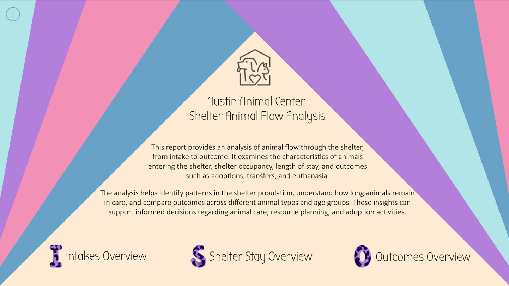
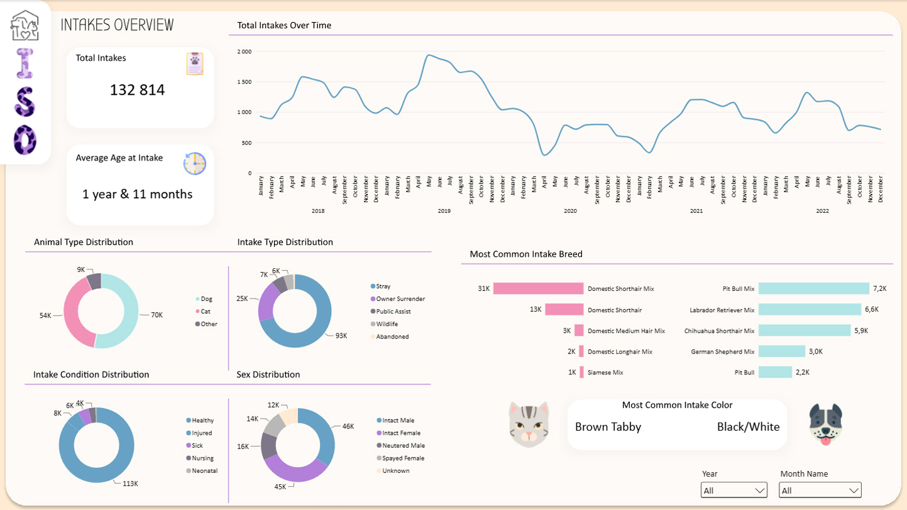
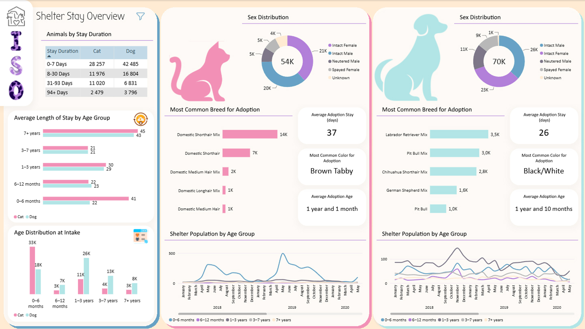
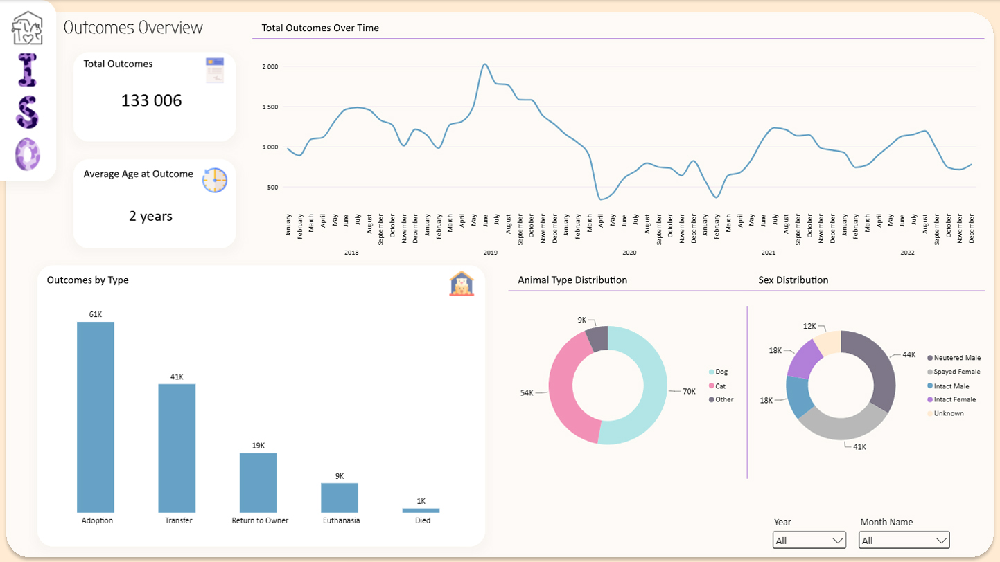

# Animal Shelter Intake, Stay & Outcome Analysis
An interactive Power BI dashboard analyzing animal intake, shelter population, length of stay, and outcome patterns based on records from 2018 to 2022.

## Interactive Dashboard

[**View Interactive Power BI Report**](https://app.powerbi.com/view?r=eyJrIjoiYjM1NTJjOTQtNzZhYi00NTMzLWE3Y2UtNWM5YTQ0N2IzNDU1IiwidCI6IjNkZmU5YWI2LTgxYmYtNDkxYy1iNjcwLTAxYzgyNGEwOWUxOSJ9)

## Goal 
Understand the flow of animals through the shelter and support informed decisions regarding animal care and adoption.

## Tools
Power BI · Power Query · DAX · M · CSV

## Model
Relational Data Model 

## Data Preparation
CSV Transformation · Age-Related Columns · Data Type Standardization · Table Merging · Length of Stay Calculation · Calendar Table · Helper Tables · DAX Measures
Key analysis: Animal Intakes · Intake Trends & Seasonality · Animal Characteristics · Shelter Population · Length of Stay · Adoptions & Outcomes

Visuals: KPI cards · Bar & Line Charts · Donut Chart · Tables 

## Key insight
-	More than 130,000 animal intakes were recorded during the five-year period, including over 70,000 dogs and 53,000 cats.
-	The average age at intake was 1 year and 11 months, with dogs being older on average than cats.
-	The highest monthly intake occurred in May 2019 (1,935 animals), while the lowest occurred in April 2020 (290 animals).
-	Most animals left the shelter within the first week, despite an average stay of 37 days for cats and 26 days for dogs.
-	Seasonal patterns were observed in both intakes and outcomes, particularly among cats.

The report provides insights into animal characteristics, intake trends, shelter stay patterns, and outcomes, helping to identify differences between dogs and cats and supporting data-informed shelter planning.

[View Full Documentation (PDF)](README.pdf)

## Dashboard Preview

### Landing Page

### Intakes Overview

### Shelter Stay

### Outcomes Overview

